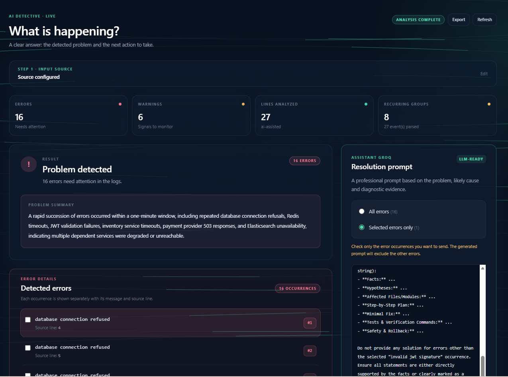

# AI Detective Frontend

The AI Detective Frontend is a standalone React dashboard for turning backend logs into clear, actionable debugging guidance.

It is intentionally separated from the Python core and the live gateway. This repository contains only the user interface: it does not start, embed, or modify the backend being inspected.

## Product scope

The dashboard gives a developer a focused workflow:

1. Choose an input source before any network request is made.
2. Connect to a live backend through the separate gateway, or upload a local JSON/JSONL log file.
3. See practical metrics: total log entries, errors, warnings, and detected services.
4. Inspect every detected error occurrence, not only a summary.
5. Select an error to read its proposed resolution steps.
6. Generate a structured prompt for one error or for the complete incident list.
7. Optionally enable AI + Stack Overflow for a bounded AI explanation and relevant external references.

The interface is optimized for desktop debugging sessions, with a two-column workspace: detailed incidents on the left and the generated resolution prompt on the right.

## The developer story

Imagine that you are working on an important backend project and a request suddenly fails. The terminal contains a long list of messages, repeated errors and warnings from several dependent services. You do not want another dashboard that hides the important details, and you do not want to copy raw logs into an AI tool without understanding what is happening first.

AI Detective gives you a practical investigation path:

1. Bring the evidence into the dashboard by connecting to a live backend or selecting a JSON/JSONL log file.
2. Read the situation at a glance through the error, warning, analyzed-line and recurring-group statistics.
3. Open every error occurrence and identify its exact source line instead of relying on a vague summary.
4. Select one error when you need a focused fix, or select all errors when the incident requires a complete diagnosis.
5. Review several concrete resolution steps, with clear attribution when Stack Overflow recommendations were used.
6. Copy a professional, structured prompt into the LLM of your choice. The prompt contains the selected evidence, probable cause, affected scope, requested tests and verification steps.

The result is a faster and more controlled debugging session: the developer keeps the facts, understands the proposed action and decides what to apply. AI Detective is an assistant for investigation, not a black box that silently changes the project.

## Product walkthrough

The screenshot below shows the desktop workspace with incident statistics, individual error occurrences and the focused prompt assistant. In this example, the developer selected one error occurrence, so the generated prompt is scoped to that error rather than the complete incident.



*AI Detective desktop dashboard: detailed evidence on the left and a focused resolution prompt on the right.*

## Repository boundaries

The projects are deliberately independent:

```text
AI-detecitve-frontend/       # this repository: React/Vite UI
AI_detective-cli/            # separate repository: Python core and live gateway
```

The frontend communicates with the gateway over HTTP. It does not contain Python files, backend fixtures, or frontend-linked files inside the Python project.

## Architecture

```text
src/
├── App.jsx                    # dashboard state, source selection and UI
├── lib/api.js                 # gateway HTTP client and report normalization
├── components/
│   └── bg-kinetic-lines.jsx   # decorative animated background
├── index.css                  # Tailwind and dashboard styles
└── main.jsx                   # React entry point
```

### Input modes

- **Live backend URL**: after the user explicitly chooses this mode, the frontend asks the gateway to discover the local backend (ports `5000` and `3000`) or accepts a backend URL supplied by the user. The gateway reads logs using its configured source strategy.
- **JSON log file**: the browser reads the selected JSON or JSONL file in memory. No backend discovery or polling is performed in this mode.

The live mode is rate-safe: the interface avoids request loops before source selection, refreshes only after a connection is established, and keeps AI/Stack Overflow lookups bounded to the current analysis.

## Prerequisites

- Node.js 18 or newer
- npm
- The separate AI Detective gateway running when live backend mode is used

## Local development

### 1. Start the separate gateway (live mode only)

From the Python repository:

```powershell
cd C:\AI_detective-cli
& .\.venv\Scripts\python.exe -m uvicorn live_gateway.api:app --app-dir services/live_gateway/src --port 8000
```

The gateway is responsible for backend discovery and log access. The backend being inspected must be started separately on its own port, commonly `5000` or `3000`.

### 2. Configure the frontend gateway URL

Copy `.env.example` to `.env.local` when the gateway is not running on the default URL:

```powershell
Copy-Item .env.example .env.local
```

Then adjust:

```dotenv
VITE_API_BASE_URL=http://127.0.0.1:8000
```

Never commit API keys or private environment values. The `GROQ_API_KEY` belongs in the separate gateway configuration, not in this frontend repository.

### 3. Start the frontend

```powershell
npm install
npm run dev
```

Vite serves the dashboard at the URL shown in the terminal, usually `http://localhost:5173`.

## Production build

```powershell
npm run build
npm run preview
```

The generated `dist/` directory is deployment output and is intentionally ignored by Git.

## Quality checklist

Before opening a pull request or publishing a release:

```powershell
npm run build
git status --short
```

Keep frontend changes inside this repository and keep backend/gateway changes inside `AI_detective-cli`.
